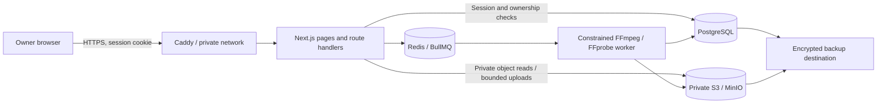

# Phase 1: architecture and repository review

Reviewed 2026-10-22 against commit `891c418` and the supplied PrivateFlix specification. This is a source review, not a security certification. Existing implementation is retained. Phase numbering below follows the user's nine-phase specification, replacing the earlier eight-phase status scheme.

## Baseline

The repository contains a Next.js starter UI, eight auth/system route handlers, authentication helpers, a Prisma schema, storage abstraction, MinIO adapter, signature checks and streaming helpers. There are no committed tests, migrations, worker, media routes, Dockerfile, production reverse proxy configuration, or backup/restore tools. The previous status file's claim that test files were ready is not supported by the checkout. Its AWS SDK and media-variant-model claims also do not match the code: storage uses the MinIO client and there is no variant model.

Host: Windows PowerShell, Node 24.15.0, npm 11.12.1. npm is the package manager because package-lock.json is committed. Docker and pnpm were not found on PATH. No existing user modifications were present after cloning.

Lockfile versions: Next.js 16.4.2; React/React DOM 19.3.0; Prisma/client 6.19.3; MinIO SDK 8.0.7; BullMQ 5.81.5; Tailwind 4.3.3; TypeScript 5.9.3; Vitest 3.2.7; Playwright 1.64.1. These are observed declarations, not a claim of verified compatibility. AGENTS.md still says Next.js 15. Many manifest dependencies use ranges; runtime/package-manager engines and container digests are not pinned. Phase 2 must reconcile these and verify a clean installation, generation, build and startup.

## Intended architecture



Only the web proxy is exposed in production. Database, Redis, bucket and storage console remain on internal networks. Development service ports bind to loopback. Browser requests never receive storage credentials, object keys or public presigned URLs. No paid service is required.

PostgreSQL is the source of truth for owner, sessions, media lifecycle, upload parts and processing/deletion records. Redis transports retryable jobs; durable database records permit reconciliation after queue loss. Redis uses noeviction for job reliability. Worker jobs use leases, idempotent outputs and bounded retries. A reconciliation task recovers incomplete transitions between database, queue and object storage.

## Security decisions and necessary repairs

| Finding in current source                                                                                            | Required implementation and acceptance evidence                                                                                                                                                                           |
| -------------------------------------------------------------------------------------------------------------------- | ------------------------------------------------------------------------------------------------------------------------------------------------------------------------------------------------------------------------- |
| Setup checks occur before the transaction; User has no single-owner constraint                                       | Add database-enforced singleton ownership, transactional setup and a server-provisioned one-time setup credential. Race two setup requests against PostgreSQL; exactly one owner may exist.                               |
| Auth mutations have no Origin validation                                                                             | Central exact-origin and expected-host enforcement, JSON content type and bounded request bodies; reject absent/untrusted origins on browser mutation endpoints. Test login/setup CSRF as well as authenticated changes.  |
| Forwarded IP headers are trusted directly; rate limits are process-local and failed attempts counted only after work | Trust only a configured sanitizing proxy; reserve attempts atomically in Redis before expensive hashing. Add an owner/global limiter, bounded keys, progressive lockouts and restart/multi-instance tests.                |
| Dummy login hash needs verification; password update and revocation occur separately                                 | Use a valid equal-cost dummy hash; transactionally update password and revoke sessions. Serialize concurrent password changes and test login/password-change races.                                                       |
| Environment validator is never imported by runtime consumers                                                         | Validate configuration at application/worker startup; remove credential fallbacks and raw unvalidated runtime configuration. Add server-only import boundaries.                                                           |
| Security header helper is not wired into next.config.ts                                                              | Apply privacy headers and nonce-compatible CSP; verify real responses and Next.js hydration. Avoid caching authenticated pages/media.                                                                                     |
| Storage policy errors are swallowed; SDK internal multipart methods are called via any                               | Separate privileged provisioning from least-privilege runtime access; fail closed on unverifiable privacy. Use supported typed multipart APIs. Test anonymous denial and authenticated read/write against actual storage. |
| Unknown signatures are accepted; RIFF subtypes are not distinguished; optional headers bypass signature checks       | Require complete bounded header validation, consistent extension/MIME/content checks and successful constrained probing before READY. Test malformed, truncated and spoofed files.                                        |
| Streaming bridge consumes flowing data without backpressure                                                          | Use a backpressure-aware bridge with cancellation, resource cleanup and safe range validation. Test slow clients, disconnects, bounded memory and 200/206/416 behavior.                                                   |
| Compose publishes backing services on all interfaces, uses fixed development passwords and mutable images            | Bind development ports to loopback; require generated credentials, pin supported images; add internal production networking, health checks and resource limits.                                                           |

Session tokens remain random 256-bit values with SHA-256 identifiers in PostgreSQL and HttpOnly, production-Secure cookies. Every request checks revocation and both idle and absolute expiry. Route guards return safe errors; all owner-owned reads and writes constrain ownerId, including joins and bulk actions. Missing and foreign resources return 404. Application health exposes only a minimal public liveness result; detailed diagnostics require owner authentication.

## Upload and delivery contracts

Authenticated upload initiation allocates an opaque server key and reserves quota. Bounded part requests pass through the authenticated app; persisted part numbers, sizes and ETags support resume. Finalization verifies stored size/checksum, idempotently records completion and queues processing. Cancellation and expiry abort storage multipart state and reclaim reserved quota. Originals stay unavailable until required content validation succeeds.

The worker streams objects to a quota-limited private temporary directory, invokes tools with argument arrays and no shell, disables unnecessary network protocols, and enforces CPU, memory, disk, process and time limits. It creates separate private thumbnails/previews. Only complete required outputs transition media to READY. Failures expose safe error codes and permit bounded retry.

Streaming routes authorize the active session and media ownership on every request, including Range and HEAD. They return correct length/type/range headers and stream from storage without whole-file buffering. Downloads and thumbnails use the same boundary. Optional HLS uses registered rendition/segment records and app-relative protected manifest URLs; manifests, initialization files, segments, captions and any keys all require authorization. Requested paths never become arbitrary storage paths.

Schema extensions will cover persisted upload parts/expiry/quota reservations, media variants/storage-object inventory, job leases/idempotency, owner preferences and optional user-defined media date. Relations must enforce ownership in transactions. Collection/playlist deletion removes memberships only; media deletion enters DELETING and a retryable cleanup job removes all registered objects before final database removal.

## Directory plan

```text
src/app/(auth)/                 setup and login
src/app/(private)/              dashboard, library, player, collections, settings
src/app/api/                   authenticated resource and delivery routes
src/components/                accessible shared UI
src/lib/auth/                  sessions, reauthentication and owner checks
src/lib/validation/            bounded schemas and environment configuration
src/lib/storage/               typed private storage adapter
src/lib/media/                 probing, signatures, ranges and derivatives
src/lib/queue/                 durable job dispatch/reconciliation
src/workers/                   processing and cleanup entry points
prisma/migrations/             reviewed versioned SQL migrations
tests/unit/                    pure behavior and failure cases
tests/integration/             real PostgreSQL, Redis and object storage
tests/e2e/                     browser owner flows and unauthorized access
deploy/                        Dockerfiles, Caddy and production configuration
scripts/                       provisioning, recovery, backup and restore
docs/                          architecture, API, operations and phase evidence
```

## Implementation order and exit criteria

| Phase             | Remaining scope                                                                                    | Gate before advancing                                                                                  |
| ----------------- | -------------------------------------------------------------------------------------------------- | ------------------------------------------------------------------------------------------------------ |
| 1 Architecture    | This review and corrected status                                                                   | Findings and plan recorded                                                                             |
| 2 Foundation      | Reproducible dependencies; validated env; formatter/lint; migrations; local Docker and app startup | Clean install, Prisma validation/generation, typecheck, lint, build, migration and startup smoke check |
| 3 Security        | Repair setup/auth/CSRF/session/rate-limit/headers; recovery procedure                              | Unit and real-service tests for setup races, expiry, revocation, CSRF and anonymous access             |
| 4 Private storage | Typed adapter, provisioning, uploads/resume/cancel/expiry/quotas                                   | Anonymous object denial; multipart and spoofed-content tests                                           |
| 5 Processing      | Worker, probe, thumbnails, retries and optional renditions                                         | Representative image/video fixtures, malformed inputs and bounded-resource tests                       |
| 6 Streaming       | Protected original/range/HLS/thumbnail/download delivery                                           | Correct 200/206/416; foreign/expired/revoked session denial; slow-client checks                        |
| 7 Frontend        | All specified pages, search, organization, playlists, history, settings and real APIs              | Accessible responsive browser flows backed by real data                                                |
| 8 Reliability     | Deletion reconciliation, backup/restore, monitoring and limits                                     | Integration/browser suite plus isolated restore drill                                                  |
| 9 Deployment      | HTTPS, internal networking, persistent volumes and recovery/runbooks                               | Production smoke/security checklist with truthful remaining limitations                                |

The supplied brief explicitly requests Phase 1 only for the first response. This review does not implement or certify later phases. Subsequent work should repair the foundation before extending the existing partial backend; prior code-complete labels do not waive verification gates.

## Services and operator configuration

Local development needs Docker Desktop/Engine with PostgreSQL 16, private MinIO and Redis; the worker image needs FFmpeg/FFprobe. Configure database credentials, restricted bucket credentials, Redis connectivity, canonical APP_URL, setup credential and limits. Generate secrets locally; commit placeholders only. Production additionally needs a host, HTTPS endpoint or private VPN/TLS arrangement, persistent encrypted storage and a separately protected backup destination/key. No external account configuration is assumed.

Once Docker is installed, the first diagnostic command is `docker version`. Do not expose the existing development Compose configuration publicly. Phase 2 will supply corrected provisioning and migration commands before asking the owner to initialize real services.

Encryption at rest is an infrastructure responsibility to configure and verify. The server/storage administrator can see decrypted media and metadata. Authenticated streaming is neither end-to-end encryption nor DRM, and cannot prevent copying by an authorized device. Backup retention affects when deleted media disappears from backups.
